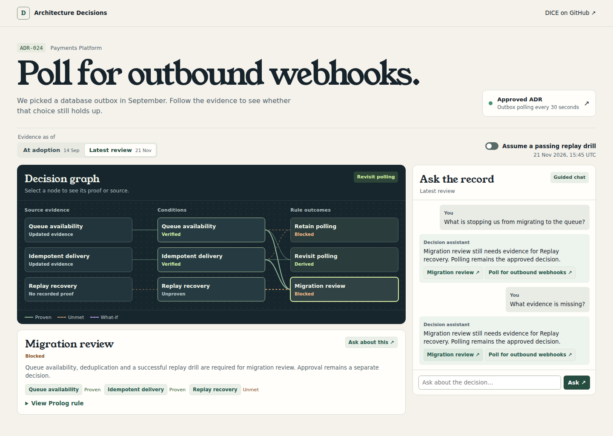
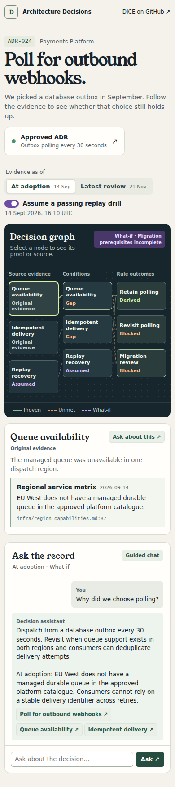
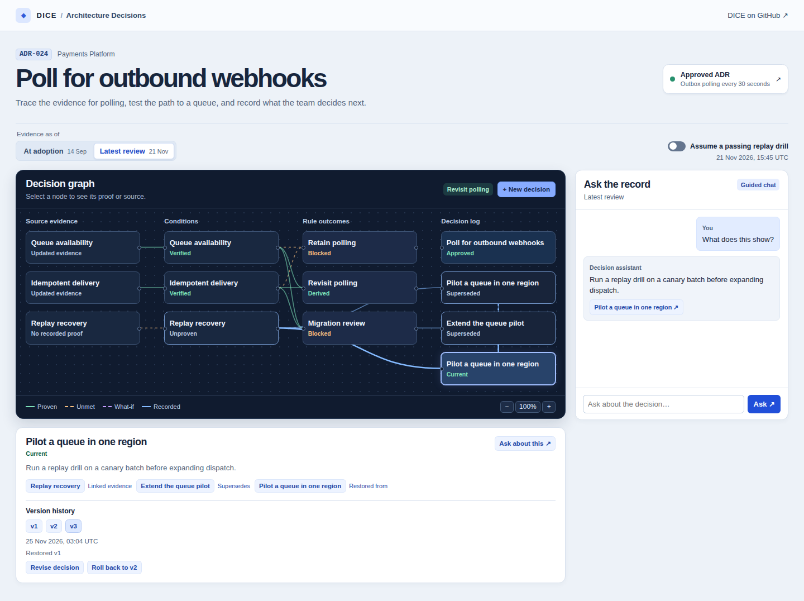

# DICE Architecture Decisions

We picked a database poller for outbound webhooks because one region had no durable queue and consumers had no stable delivery ID. Both gaps closed. The replay drill still hadn't passed. Open the graph, follow the evidence, and decide what the team should record next.



## Run it

Use Java 21, Node.js 22.12 or newer, and Bun. Maven builds the TypeScript workbench and packages its fingerprinted assets in the Spring Boot jar.

```sh
./mvnw -B clean verify
java -jar target/dice-architecture-decisions.jar
```

The workbench listens on loopback. Run a second example on a different port if it also uses 8082. [Open Architecture Decisions](http://127.0.0.1:8082)

Set `OPENAI_API_KEY` for live Embabel chat. The configured OpenAI model receives the selected graph, source excerpts, recorded decision text, and the recent conversation. Set `DECISIONS_CHAT_MODEL` to override `gpt-4.1-mini`. Without a key, the app uses guided chat. Add `--spring.profiles.active=offline` to use guided chat with a key still in your environment.

## Walk the graph

1. Pick **At adoption**. Follow the queue and idempotency checks into **Retain polling**, then open **Approved ADR** to read what the team signed off on.
2. Switch to **Latest review**. Select a source, condition, or outcome to inspect it. **View Prolog rule** shows the actual rule for an outcome. Drag the canvas to pan or use the zoom controls and percentage button to reset.
3. Ask what blocks migration, in your own words. Click an answer citation to open that node. Out-of-scope questions get a suggestion the record can answer.
4. Turn on **Assume a passing replay drill**. Follow the hypothetical path into **Migration review**. The recorded ADR and decision versions stay as they were.

<details>
<summary>At adoption on a phone</summary>



</details>

## Record a decision and roll it back

1. In **Latest review** with the scenario off, select a related node and click **New decision**. Give it a title and rationale. The linked node is selected for you and you can change it before saving.
2. Select the new node in **Decision log**. Click **Revise decision**, then change the title, rationale, or link. The graph shows the replacement and its predecessor.
3. Open an earlier version or click **Roll back to v1** on the current version. Restoring creates a new current version with the earlier wording and evidence link. Every version remains navigable and citable.



DICE stores versions as append-only propositions in `data/decision-history.json`. Set `DECISIONS_HISTORY_FILE` to keep the log somewhere else. This is a single-process local workbench. Open the same history file to pick up where you left off.

## How it works

The original ADR is an in-memory, time-scoped DICE record. Its Prolog rules determine whether the source evidence supports keeping the poller, reopening the ADR, or reviewing a migration. A what-if run projects one assumed fact into the selected checkpoint. Operator-recorded decisions have their own DICE context and appear in the latest workbench alongside the proof. [DecisionNotebook](src/main/java/example/architecture/DecisionNotebook.java) · [DecisionRecord](src/main/java/example/architecture/DecisionRecord.java)

The TypeScript client uses D3 for graph geometry and navigation and `HttpAgent` from `@ag-ui/client` for chat. The Spring endpoint receives a `RunAgentInput` and emits the AG-UI run, state, and text events over SSE. A `decision.citations` event carries verified node IDs. The same read-only Embabel action sees the selected graph and recent turns in live mode. [TypeScript workbench](web/workbench.ts) · [DecisionAgUi](src/main/java/example/architecture/DecisionAgUi.java) · [DecisionAgent](src/main/java/example/architecture/DecisionAgent.java)

| Endpoint | What it does |
| --- | --- |
| `GET /api/decision?revision=review&replayDrill=true` | Reads the selected proof graph and decision history |
| `POST /api/decision/versions` | Appends a decision, revision, or restoration. A revision carries the expected current version ID |
| `POST /api/decision/agent` | Streams an AG-UI run |
| `GET /api/decision/chat` | Returns the configured chat mode |
| `POST /api/decision/chat` | Returns a single JSON reply for direct API callers |

An AG-UI request includes the checkpoint and scenario in `state` and can carry a graph node as `forwardedProps.focus`.

```json
{
  "threadId": "adr-024",
  "runId": "first-question",
  "state": {"revision": "review", "replayDrill": false},
  "messages": [{"id": "question-1", "role": "user", "content": "What would let us review migrating?"}],
  "tools": [],
  "context": [],
  "forwardedProps": {"focus": "migrate"}
}
```

## Verify

The Maven suite covers the packaged frontend, proof and scope, durable decision versions, stale edits, and an Embabel action against a scripted provider. The Chromium suites exercise the graph, AG-UI chat, citations, checkpoints, and the write and rollback workflow. They run without an API key. GitHub Actions attaches the captures.

```sh
./mvnw -B clean verify
bunx playwright install chromium
bun run test:browser
```
